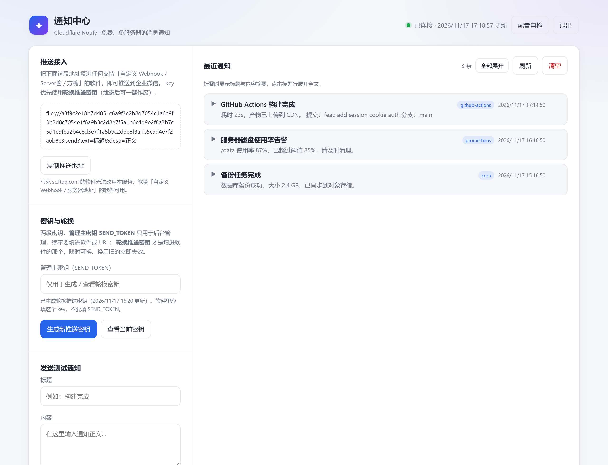

# Cloudflare Notify 完整部署教程（GitHub 导入 · 2026 版）

本文带你从零部署这套通知工具：从 GitHub 导入 Cloudflare Workers，到能发消息、收到企业微信推送、绑定自己的域名。按 `GITHUB_DEPLOY.md` 全篇操作即可，无需本地环境。

项目仓库：`https://github.com/P4x1s/cloudflare-notify`

部署完成后你看到的界面：



---

## 目录

- [0. 先看清三个概念，避免走弯路](#0-先看清三个概念避免走弯路)
- [1. 前置准备](#1-前置准备)
- [2. 从 GitHub 导入部署（Workers · 核心步骤）](#2-从-github-导入部署核心步骤)
- [2B. 如果你建的是 Pages 项目（出现 pages.dev 就看这节）](#2b-如果你建的是-pages-项目出现-pagesdev-就看这节)
- [3. 验证页面能打开](#3-验证页面能打开)
- [4. 绑定 KV 命名空间（让消息能存下来）](#4-绑定-kv-命名空间让消息能存下来)
- [5. 配置密钥 Secrets](#5-配置密钥-secrets)
- [6. 发送测试消息，验证全链路](#6-发送测试消息验证全链路)
- [7. 绑定自定义域名（可选但推荐）](#7-绑定自定义域名可选但推荐)
- [8. 日常使用：三种发送消息方式](#8-日常使用三种发送消息方式)
- [9. 自动部署：改代码后自动上线](#9-自动部署改代码后自动上线)
- [10. 免费额度说明](#10-免费额度说明)
- [11. 常见错误对照表](#11-常见错误对照表)
- [12. 另一种部署方式：在线粘贴单文件](#12-另一种部署方式在线粘贴单文件)

---

## 0. 先看清三个概念，避免走弯路

### Workers 还是 Pages？—— 两种都能跑，不用删库重建

Cloudflare 后台有两个入口。本项目**两个都支持**，仓库里各放了一份入口文件：

| 入口 | 运行方式 | 用哪个文件 |
| --- | --- | --- |
| **Workers** | 按 `wrangler.toml` 的 `main = "worker.js"` 执行一段服务端代码 | `worker.js` |
| **Pages** | 用 advanced mode，让根目录的 `_worker.js` 接管全部请求 | `_worker.js`（新建） |

**怎么判断你建的是哪个？只看域名后缀，这是唯一可靠判据：**

- `xxx.<你的子域>.workers.dev` → **Workers**
- `xxx.pages.dev`，且部署详情里出现 `<hash>.项目名.pages.dev` → **Pages**

> 你之前的 404 是因为建成了 Pages：Pages 默认去找静态 `index.html`，仓库没有，于是 404。**这不是死路，也不用删库重建**——仓库现已加入 `_worker.js`（Pages advanced mode），Pages 项目直接重新部署就能正常运行，你已绑定的自定义域名也会保留。Pages 的操作见第 2B 节。

### 三种"变量"分别放什么

| 类型 | 放哪里 | 例子 |
| --- | --- | --- |
| 代码配置 | GitHub 仓库里的 `wrangler.toml` | Worker 名称、入口文件 |
| 绑定 Binding | Dashboard → Settings → Bindings | KV 命名空间 `NOTIFICATIONS` |
| 密钥 Secret | Dashboard → Settings → Variables → Secrets | `SEND_TOKEN`、`WECOM_WEBHOOK` |

**密钥绝不写进 GitHub 仓库**——仓库是公开的，写进去等于把发消息权限公开。

### 部署成功的判断标准

不是"页面能开"就算完，完整可用要满足三条，逐项在 `/api/status` 里能看到：
1. `diagnostics.kvBound = true` 且 `kvOk = true`（存储可用）
2. `needSendToken = true`（发送密钥已设）
3. 配了企微时 `wecomConfigured = true`（推送可用）

---

## 1. 前置准备

只需两样，都免费：

1. **Cloudflare 账号**：到 `dash.cloudflare.com` 注册，邮箱验证即可。免费版足够，无需绑卡。
2. **GitHub 账号**：本项目已上传到 `https://github.com/P4x1s/cloudflare-notify`，你可直接用这个仓库导入；若想改成自己的，点右上角 Fork。

> 用现成仓库导入即可，不必重新上传。仓库里已包含全部代码与配置，且不含任何密钥。

---

## 2. 从 GitHub 导入部署（核心步骤）

以下按 Cloudflare 2026 年当前界面（官方文档 2026-10-28 更新）：

1. 登录 Cloudflare Dashboard → 左侧 **Workers & Pages**。
2. 点 **Create application**。
3. 在来源里选 **GitHub**（会列出 Artifacts / GitHub / GitLab 三个选项，选 GitHub）。首次使用会要求 GitHub 授权，点授权并同意。
4. 在仓库列表里选中 `cloudflare-notify`（可用搜索框过滤）。
5. 进入配置页，按下面填：

   | 配置项 | 填写值 | 说明 |
   | --- | --- | --- |
   | Project name / Worker name | `cloudflare-notify` | **必须与 `wrangler.toml` 里的 `name` 完全一致**，否则构建失败 |
   | Production branch | `main` | 默认即可 |
   | Root directory | 留空（仓库根目录） | 配置文件在根目录 |
   | Build command | 留空 | 单文件 Worker 无需构建 |
   | Deploy command | `npx wrangler deploy` | 若已自动填好就不用改 |

   > 官方明确要求：Dashboard 里的 Worker 名称必须匹配 `wrangler.toml` 的 `name`。本仓库该值是 `cloudflare-notify`，照填即可。

   > **关于 API token**：新版中文界面的「构建」页里**没有**单独叫"API token"的设置项——它在「**变量和密钥**」区域（那行"配置 API 令牌和其他运行时变量"）。若报 `CLOUDFLARE_API_TOKEN` 错误，按本步末尾的方法创建令牌并添加为 Secret。

6. 点 **Save and Deploy**，等待首次构建完成（通常十几秒）。
7. 成功后 Cloudflare 会给出 `https://cloudflare-notify.<你的子域>.workers.dev` 地址。

> 如果构建失败并提示找不到 KV namespace：确认你用的是本仓库的 `wrangler.toml`——它已注释掉占位符 KV 绑定，不会触发这个错误。

---

## 2B. 如果你建的是 Pages 项目（出现 pages.dev 就看这节）

**先判断**：部署详情页的 Domains 里只要出现 `xxx.pages.dev`，或 Deployment URL 是 `https://<hash>.项目名.pages.dev`，就是 Pages 项目。此节专门解决它。

好消息：**不用删库重建**。仓库已内置 `_worker.js`（Pages advanced mode 入口），内容与 `worker.js` 完全一致。Pages 会用 `_worker.js` 接管整个站点的所有请求，你已绑定的自定义域名也会保留。你之前看到 404，是因为 Pages 默认找静态 `index.html`，而项目没有——加上 `_worker.js` 后这个问题就消失了。

**操作步骤**：

1. **确认仓库已含 `_worker.js`**：到 `https://github.com/P4x1s/cloudflare-notify` 看根目录，应有 `worker.js` 和 `_worker.js` 两个文件。本教程对应版本已包含。若没有，从本仓库拉取最新版本，或复制一份 `worker.js` 命名为 `_worker.js` 提交上去。
2. **检查构建配置**：进入该 Pages 项目 → **Settings** → **Builds**（或 Build & deploy）：
   - **Build command（构建命令）**：留空，或填 `exit 0`。**不要**填 `npx wrangler deploy`——那是 Workers 的部署命令，在 Pages 里会制造 `CLOUDFLARE_API_TOKEN` 报错且不会产出 `_worker.js`。
   - **Build output directory（构建输出目录）**：填 `/`（仓库根目录），确保 Pages 能找到根目录的 `_worker.js`。
   - **Root directory**：留空。
3. **重新部署**：配置改动后点 **Save**，再到 **Deployments** 点最新构建的 **Retry**；或 push 任意一次提交触发重建。等待状态变绿。
4. **验证**：打开 `https://xxx.pages.dev` 或你绑的自定义域名，出现带「配置自检」「发送测试通知」卡片的页面即成功。再访问 `/api/status`，应返回含 `"version": "1.2.0"` 的 JSON。

**Pages 项目的密钥与 KV 配置和 Workers 的菜单位置不同，按这里填**（变量名完全一样，代码不用改）：

| 配置项 | Pages 里的位置 | 变量名 / 说明 |
| --- | --- | --- |
| 发送密钥 | Settings → **Environment variables** → Add | `SEND_TOKEN`（选 Production 环境） |
| 查看密钥（可选） | 同上 | `READ_TOKEN` |
| 企微推送（可选） | 同上 | `WECOM_WEBHOOK`，值填群机器人 Webhook 地址 |
| KV 存储 | Settings → **Bindings** → Add → **KV namespace** | Variable name 填 `NOTIFICATIONS`（全大写） |

> 密钥在 Environment variables 里建议选 **Secret（加密）** 类型。环境变量和绑定改动后需 **Redeploy（重新部署）** 才生效。
>
> 官方依据：Pages advanced mode 允许用根目录 `_worker.js` 接管全部请求（本项目自身处理所有路径、无静态资源，故无需 `env.ASSETS.fetch()`）；Pages 环境变量在 Settings → Environment variables，KV 绑定在 Settings → Bindings → Add → KV namespace。

---

### 构建报 `CLOUDFLARE_API_TOKEN` 未设置怎么办

如果构建日志出现：

```
In a non-interactive environment, it's necessary to set a CLOUDFLARE_API_TOKEN environment variable
```

原因是云端构建是非交互式的，wrangler 无法弹窗登录，需要一个 **API token（API 访问令牌）** 认证。

**先看清一件事：这个报错只可能发生在 Workers 项目**

`CLOUDFLARE_API_TOKEN` 报错来自 `npx wrangler deploy`，这是 **Workers** 的部署命令。新版控制台把 Workers 和 Pages 的设置页合并了，两处的「绑定」「运行时」文案、甚至构建命令栏都可能看起来很像，**不能再靠"构建命令/兼容日期"这些字样判断项目类型**。

**唯一可靠判据是域名后缀**：去部署详情页看 Domains / Deployment URL——
- 是 `xxx.<子域>.workers.dev` → Workers 项目，按下面步骤加令牌；
- 是 `xxx.pages.dev` → Pages 项目，请跳到第 **2B 节**：Pages 根本不需要 `npx wrangler deploy` 和这个令牌，把构建命令改成留空/`exit 0`、用 `_worker.js` 即可，报错自然消失。

**在「变量和密钥」里加令牌（新版中文界面的正确位置）**

新版界面「构建」页里**没有**单独叫"API token"的设置项，正确入口是「**变量和密钥**」区域——也就是那行"配置 API 令牌和其他运行时变量"：

1. 创建令牌：右上角头像 → **My Profile** → **API Tokens** → **Create Token**，选 **Edit Cloudflare Workers** 模板 → 一路 Continue to summary → **Create Token** → 复制令牌（**只显示一次**）。
   - 若没有该模板，就自定义，至少包含账户权限 `Workers Scripts: Edit` 和 `Workers KV Storage: Edit`。
2. 回到该 Worker → **Settings** → **构建** → 「**变量和密钥**」区域 → 点 **+ 添加**。
3. 添加一条：**名称** `CLOUDFLARE_API_TOKEN`，**值**粘贴令牌，类型选 **Secret（机密）** 加密存储。
4. **Save** → **Deployments** → 点失败构建的 **Retry**（重试）。

> 令牌是你的账户凭证，只放在 Cloudflare 后台，绝不要写进 GitHub 仓库或 `wrangler.toml`。这就是为什么你按官方"自动生成"的说明找不到那一项——当前中文界面把它收敛到了「变量和密钥」里手动配置。

---

## 3. 验证页面能打开（部署成功却 404 看这里）

**先记住一个确定性结论**：本项目的 `/` 首页直接返回内嵌页面、不读 KV、不依赖任何外部文件。所以只要看到的是 **404**，就说明**请求没有到达这段代码**——这不是 `worker.js` 的问题，而是「访问地址」或「部署」层面的问题。按下面顺序排查即可。

### 3.1 用 Dashboard 给的地址，不要自己拼

`workers.dev` 地址格式是 `cloudflare-notify.<你的账户子域>.workers.dev`，注意两点：

- 中间那段 `<你的账户子域>` 是你账户独有的，不是固定值；在 **Workers & Pages** 页右上角 **Your subdomain** 处可见或可改。
- 若 `cloudflare-notify` 这个名字已被占用，Cloudflare 会自动加后缀，变成 `cloudflare-notify-xxxx.<子域>.workers.dev`。

**最可靠做法**：进入 **Workers & Pages** → 点开你的 Worker（`cloudflare-notify`）→ 在概览页顶部找到 **Visit（访问）** 按钮或显示的 `workers.dev` 地址，**直接点它**打开。不要手动拼 URL——拼错子域或漏掉后缀是 404 的头号原因。

### 3.2 用 /api/status 一锤定音

在地址栏把路径换成 `/api/status` 后回车：

- 返回一段含 `"version": "1.4.0"` 的 JSON → Worker 完全正常。此时首页 404 只是地址或路径写错，回到 3.1 用 **Visit** 按钮打开根路径 `/`。
- 返回 `{"ok":false,"error":"unauthorized"}`（HTTP 401）→ 你配置了 `READ_TOKEN`，接口需要凭据。这**不是错误**：见 3.2.1 用密钥换取会话。
- 仍返回 Cloudflare 品牌的 404 错误页 → 请求根本没到 Worker，按 3.3 继续排查。
- 返回 1010 / 1020 错误 → `workers.dev` 的浏览器完整性检查拦截，换普通浏览器，或做第 7 步绑定自定义域名。

### 3.2.1 已配置 `READ_TOKEN` 时怎么验证（v1.4.0 起）

配置 `READ_TOKEN` 后，**页面和只读接口都需要凭据**。此时：

- 浏览器打开 `https://<你的地址>/` → 看到的是**独立登录页**（输入 READ_TOKEN 的那个），不是通知主页。
- 这不是 bug，是预期行为。

三种进入方式，任选其一：

```bash
# 方式一：命令行用密钥换会话 Cookie（推荐，密钥不进浏览器历史）
curl -i -X POST "https://<你的地址>/api/login" \
  -H "Content-Type: application/json" \
  -d '{"token":"<READ_TOKEN>"}' -c cookie.txt
# 之后 curl -b cookie.txt "https://<你的地址>/api/status" 即可

# 方式二：直接给接口带上密钥
curl -H "X-Token: <READ_TOKEN>" "https://<你的地址>/api/status"

# 方式三：浏览器打开 /?token=<READ_TOKEN>
# 服务端会换发会话 Cookie 并 302 到干净地址（不带 token），密钥不会留在历史里
```

浏览器里直接输 `READ_TOKEN` 登录后，服务端会下发 `cfn_session` 会话 Cookie（HttpOnly / SameSite=Strict / 7 天），之后刷新页面都不需要再输。

> **为什么改成了这样？** v1.3 的登录只是前端盖了一层遮罩，页面 HTML 里始终带着推送地址和密钥——用开发者工具删掉那个 div 就能直接看到，属于真实漏洞。v1.4 改成**服务端鉴权后才下发完整页面**：未验证的响应里根本没有那些 DOM。

### 3.3 仍是 404 的排查顺序

1. **确认部署真的成功**：进入该 Worker → **Deployments**，看最新一条构建状态是否为 **Success**，且 Active Deployment 指向它。若最近一次是 **Failed**，点 **Retry**。
2. **确认 `workers.dev` 路由没被关**：该 Worker → **Settings** → **Domains & Routes** → `workers.dev` 应显示 **Enabled**；若是 **Disabled** 就点启用（默认是开启的，但手动关过就会 404）。
3. **确认项目类型与访问地址匹配**：地址结尾是 `.workers.dev` → 按本节排查；地址结尾是 `.pages.dev` → 你建的是 Pages 项目，请直接看 **第 2B 节**（Pages 用 `_worker.js`，不用删库重建）。
4. **确认只访问根路径**：地址形如 `https://xxx.workers.dev/` 或 `https://xxx.pages.dev/`，末尾不要带多余路径。
5. **国内网络干扰**：`*.workers.dev` 在国内常被干扰，做第 7 步绑定自定义域名后改用自定义域名访问。

> **如果以上都确认无误仍 404**，请把两样东西发出来以便精确定位：浏览器地址栏的**完整 URL**，以及 404 **页面长什么样**（Cloudflare 品牌错误页 / 浏览器自带错误页 / 其他）。这两项是线上信息、只能由你提供，拿到后即可给出确定结论。

再访问 `https://<你的地址>/api/status`，应返回类似这样的 JSON（这是页面自检数据）：

```json
{
  "ok": true,
  "service": "cloudflare-notify",
  "version": "1.4.0",
  "single_file": true,
  "needSendToken": false,
  "needReadToken": false,
  "wecomConfigured": false,
  "diagnostics": {
    "kvBound": false,
    "kvOk": false,
    "kvError": "",
    "serverchanReady": false
  }
}
```

> 已配置 `READ_TOKEN` 时这个接口也会返回 401，需按 3.2.1 带凭据访问。

刚部署时 `kvBound/needSendToken` 是 `false` 属于正常——还没绑定，接下来两步补上。

---

## 4. 绑定 KV 命名空间（让消息能存下来）

KV 是 Cloudflare 的键值存储，用来保存通知消息。不绑定时页面能开，但发消息会失败。

1. 该 Worker → **Settings** → **Bindings** → **Add** → **KV Namespace**。
2. **Variable name** 精确填写 `NOTIFICATIONS`（全大写，大小写敏感，代码靠这个名字找 KV）。
3. KV Namespace 选 **Create new namespace**，名称如 `cloudflare-notify-kv`，创建后选中它。
4. 点 **Add binding** 保存。立即生效，无需重新部署。

验证：刷新 `/api/status`，`diagnostics.kvBound` 和 `kvOk` 都变成 `true` 即成功。

> 为什么写在 Dashboard 而不是 `wrangler.toml`？KV 的 ID 是每个人账户独有的，无法预置。本仓库的 `wrangler.toml` 刻意未声明 KV，因此 Dashboard 添加的绑定不会被后续 GitHub 部署覆盖。若你日后想改成写进配置文件，见 `wrangler.toml` 底部注释。

---

## 5. 配置密钥 Secrets

该 Worker → **Settings** → **Variables** → **Secrets** → **Add**，逐个添加：

| 变量名 | 是否必填 | 作用 |
| --- | --- | --- |
| `SEND_TOKEN` | 强烈建议 | **管理主密钥**：用于轮换/查看推送密钥，也可发送。不进 URL，只在后台管理用。不设则任何人都能发消息且无法轮换 |
| `READ_TOKEN` | 可选但推荐 | 查看页面与只读接口的查看密钥。**一旦设置，网页会变成需要登录的状态**（未验证只能看到独立登录页，看不到推送地址与密钥）。留空则查看页面完全公开 |
| `WECOM_WEBHOOK` | 可选 | 企业微信群机器人 Webhook 完整 URL；配了才会主动推群 |

**两级密钥与轮换（v1.3）**：`SEND_TOKEN` 是管理主密钥（Secret，不可轮换），给软件填的应是另一个**轮换推送密钥**——在通知页「密钥与轮换」区域填入 `SEND_TOKEN` 后点「生成新推送密钥」即得，或调用 `POST /api/key/rotate -H "X-Token: <SEND_TOKEN>"`。轮换后旧 key 立即失效，无需重新部署。密钥也可用 `X-Token` Header 或 POST body 传递，避免进入 URL 历史与日志。详见 `README.md` 第 3.3 节。

**查看登录与会话（v1.4.0）**：设置了 `READ_TOKEN` 后，访问网页会看到独立登录页，输入 `READ_TOKEN` 即可进入。验证通过后服务端签发 `cfn_session` 会话 Cookie（HMAC 签名、HttpOnly、7 天有效），密钥不会保存在浏览器本地。

- 会话签名密钥就是 `READ_TOKEN` → **改 `READ_TOKEN` 会让所有旧会话立刻失效**，这是最方便的「一键踢下线」。
- 想退出，点页面右上角「退出」，会清除 Cookie。
- 同一 IP 5 分钟内登录失败 8 次会被临时锁定（返回 429），防止被暴力猜解。
- 想要完全公开的查看页，**把 `READ_TOKEN` 删掉**即可（但那样任何人都能看到通知内容）。

**生成 `SEND_TOKEN`**：用任意密码生成器生成 32 位以上随机字符串，或用命令：

```bash
openssl rand -hex 24
```

**获取 `WECOM_WEBHOOK`**：企业微信 App → 进入群聊 → 右上角「…」→ 群机器人 → 添加机器人 → 复制 Webhook 地址，形如：

```
https://qyapi.weixin.qq.com/cgi-bin/webhook/send?key=你的key
```

> 这些值只存在于 Cloudflare 后台，保存即生效，不要写进代码或 GitHub。Webhook 地址等同于发消息凭证，泄露后可在群机器人设置里重置。

验证：刷新 `/api/status`，`needSendToken` 和 `wecomConfigured` 应为 `true`。

---

## 6. 发送测试消息，验证全链路

浏览器直接打开（把尖括号内容换成你自己的值）：

```
https://<你的域名>/send?token=<SEND_TOKEN>&title=测试&content=来自Cloudflare
```

返回 `"ok": true` 即发送成功。此时：

- 打开通知页面能看到这条消息 = KV 存储正常；
- 若配了 `WECOM_WEBHOOK`，响应里还有 `"wecom": {"configured": true, "ok": true}` = 企业微信也收到了推送。

也可以点页面上的「测试企微推送」按钮验证连通性（需先设 `SEND_TOKEN`）。

---

## 7. 绑定自定义域名（可选但推荐）

`*.workers.dev` 在国内访问有时不稳定，绑定自己的域名更可靠，也让推送地址更好记。

**前提**：你的域名已接入 Cloudflare（Nameservers 指向 Cloudflare），且该域名下要绑定的主机名没有已存在的 CNAME 记录。

1. 该 Worker → **Settings** → **Domains & Routes** → **Add** → **Custom Domain**。
2. 填入域名，如 `notify.example.com`（可用子域名，避免影响主站）。
3. 点 **Add Custom Domain**。

Cloudflare 会自动创建 DNS 记录并签发 SSL 证书（免费，无需你配置）。等待几十秒生效后，用 `https://notify.example.com` 访问即可。

> 域名必须是在 Cloudflare 账户下激活的 zone；不能用别人的域名，也不能绑到已有 CNAME 的主机名。

---

## 8. 日常使用：三种发送消息方式

部署完成后，这个工具就是一个 HTTP 接口，任何能发 HTTP 请求的东西都能对接。

### 方式一：浏览器 / 快捷指令（最简单）

```
https://<你的域名>/send?token=<SEND_TOKEN>&title=标题&content=正文
```

### 方式二：curl / 脚本（通用）

```bash
curl "https://<你的域名>/send?token=<SEND_TOKEN>&title=构建完成&content=耗时 23s"
```

项目 `examples/notify.py` 是零依赖的 Python 脚本，支持位置参数、`--stdin` 管道，适合接入各种软件：

```bash
NOTIFY_URL="https://<你的域名>/send?token=<SEND_TOKEN>" python notify.py "标题" "正文"
```

Node、PowerShell、GitHub Actions 的等价写法见 `examples/README.md`。

### 方式三：方糖 / Server酱风格 key（给只让填 key 的软件）

你的 `SEND_TOKEN` 就是 key，专属推送地址：

```
https://<你的域名>/<SEND_TOKEN>.send?text=标题&desp=正文
```

兼容方糖的 `text`/`desp` 参数，也兼容 `title`/`content`，返回体同时带 `errno` 和 `code` 双码。

> 限制：只有支持「自定义 Webhook URL / 服务器地址」的软件能填这个完整地址。把域名写死为 `sc.ftqq.com`、只让你填一串 key 的软件无法迁移——它不会把消息发到你的域名。

---

## 9. 自动部署：改代码后自动上线

通过 Workers Builds 导入后，已自动开启 Git 集成：

- 你往 `main` 分支 push 一个 commit → Cloudflare 自动构建并部署新版本。
- 在 Dashboard 该 Worker → **Deployments** → **View build history** 可看每次构建状态和日志（保留 90 天）。
- 非生产分支的构建会生成 Preview（预览环境），不影响线上。

若想临时停止自动上线、只构建不发布，把 Deploy command 改为：

```
npx wrangler versions upload
```

这样每次 push 只生成版本，不会自动切到线上，可手动回滚或发布。

---

## 10. 免费额度说明

Cloudflare 免费版完全够个人通知使用：

| 资源 | 免费额度 | 本项目消耗 |
| --- | --- | --- |
| Workers 请求 | 100,000 次/天 | 页面每 5 秒轮询，单人常开约 17,280 次/天 |
| KV 读取 | 100,000 次/天 | 页面已做增量检查，无新消息时每次仅 1 次读取 |
| KV 写入 | 1,000 次/天 | 发一条消息 = 1 次写入 |
| KV 存储 | 1 GB | 单条正文上限 2 万字符 |
| Workers Builds | 3,000 构建分钟/月 | 单文件构建十几秒，个人更新频率远用不完 |
| 自定义域名 + SSL | 免费且不限 | 可绑多个域名 |

> 若有大量高频事件，先聚合再发，避免触及 KV 写入上限。

---

## 11. 常见错误对照表

| 现象 | 原因 | 处理 |
| --- | --- | --- |
| 404 Not Found，域名是 `.pages.dev` | 建成 Pages 且没有静态 `index.html` | **不用重建**：按第 2B 节用 `_worker.js`，构建命令留空/`exit 0`、输出目录 `/`，重新部署 |
| 404 Not Found，域名是 `.workers.dev` | 访问地址错或 workers.dev 路由被关 | 按第 3 节：用 Dashboard 的 Visit 按钮打开、检查 Domains & Routes |
| 打开网页看到的是「访问验证」登录页，不是通知主页 | 设了 `READ_TOKEN`（v1.4.0 起这是预期行为） | 输入 `READ_TOKEN` 进入；或按 3.2.1 用 `?token=` / `X-Token` 访问。**这不是故障** |
| `/api/status` 返回 `{"ok":false,"error":"unauthorized"}` | 同上，接口也需要凭据 | 按 3.2.1 带 `X-Token` 或会话 Cookie 访问 |
| 登录提示「尝试次数过多，请稍后再试」 | 同一 IP 5 分钟内失败 8 次被限速 | 等 5 分钟；或换个网络；确认 READ_TOKEN 没输错 |
| 登录成功后刷新又要求重新登录 | 浏览器拒绝了 Cookie（如 https 与 http 混用、隐私模式） | 用 https 访问；确认地址栏不是 http |
| 构建报 `In a non-interactive environment, it's necessary to set a CLOUDFLARE_API_TOKEN` | Workers 云端非交互构建缺 API token | 若是 Workers 项目：见第 2 步末尾加 Secret `CLOUDFLARE_API_TOKEN` → Retry；**若是 Pages 项目**：说明构建命令误填了 `npx wrangler deploy`，按第 2B 节改成留空/`exit 0` 即可 |
| 无法判断是 Workers 还是 Pages | 新版控制台设置页文案共用 | **只看域名后缀**：`.workers.dev` = Workers；`.pages.dev`（含 `<hash>.项目名.pages.dev`）= Pages。不要靠构建命令或「Pages Functions」字样判断 |
| 构建失败，提示 Worker name 不匹配 | Dashboard 名称与 `wrangler.toml` 的 `name` 不一致 | 统一填 `cloudflare-notify` |
| 构建失败，报 KV namespace 找不到 | `wrangler.toml` 里 KV ID 是占位符 | 用本仓库版本（已注释掉 KV 绑定） |
| 页面能开但发消息 500 | KV 未绑定 | 按第 4 步绑定 `NOTIFICATIONS` |
| `/api/status` 里 `needSendToken:false` | 没设 `SEND_TOKEN` | 按第 5 步添加 Secret |
| 企业微信没收到消息 | `WECOM_WEBHOOK` 未配或已失效 | 重新获取 Webhook，更新 Secret；点「测试企微推送」验证 |
| 地址被占用 | workers.dev 子域名全局唯一 | 改 `wrangler.toml` 的 `name`，push 后重新部署 |
| `workers.dev` 打不开（超时） | 国内网络对该域名不稳定 | 按第 7 步绑定自定义域名 |
| 自定义域名添加失败 | 域名未接入 Cloudflare，或该主机名已有 CNAME | 先把域名接入 Cloudflare，删掉冲突的 CNAME 记录 |

---

## 12. 另一种部署方式：在线粘贴单文件

如果不想用 GitHub，也可以直接粘贴部署（适合临时试用）：

1. Workers & Pages → Create application → **Workers** → **Create Worker**。
2. 起名（如 `cloudflare-notify`）→ Deploy。
3. 点 **Edit code**，把 `worker.js` 的全部内容粘贴进去，覆盖默认代码 → **Save and deploy**。
4. 之后同样按第 4、5 步绑定 KV 和设置 Secrets。

> 在线粘贴方式不自带 Git 自动部署，每次改代码都要手动粘贴；GitHub 导入方式改完 push 即上线，长期维护更省事。

---

## 附：本项目文件说明

| 文件 | 作用 |
| --- | --- |
| `worker.js` | 核心单文件：路由、KV 存储、Web 页面、企业微信推送、方糖兼容端点、会话鉴权全在这里 |
| `_worker.js` | 与 `worker.js` 内容完全相同，Pages advanced mode 入口（见第 2B 节） |
| `wrangler.toml` | Workers 部署配置（已避开占位符 KV 陷阱） |
| `GITHUB_DEPLOY.md` | 本文档 |
| `README.md` / `TROUBLESHOOTING.md` | 接口文档与排查手册 |
| `.dev.vars.example` | 环境变量模板（无真实密钥） |
| `examples/` | 软件接入脚本 `notify.py` 与说明 |
| `src/` | 历史多文件版，仅作参考，不参与部署 |

敏感文件 `.dev.vars` 已排除，仓库内不含任何真实 Webhook 或密钥。
