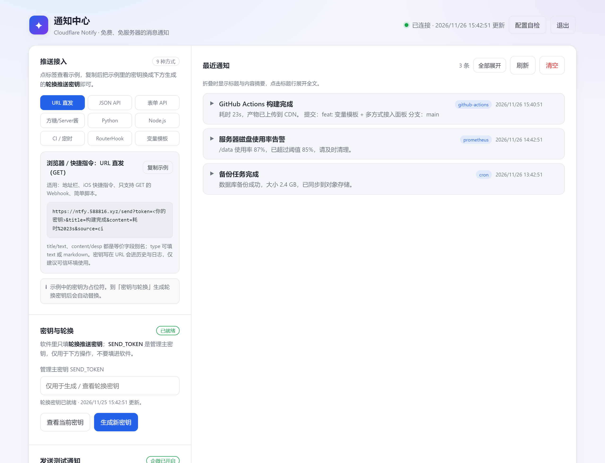
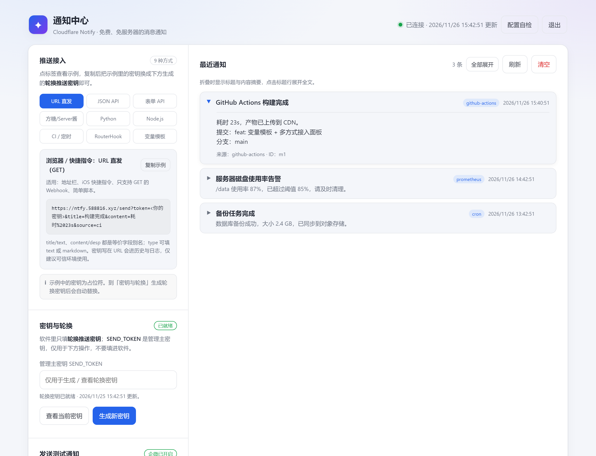
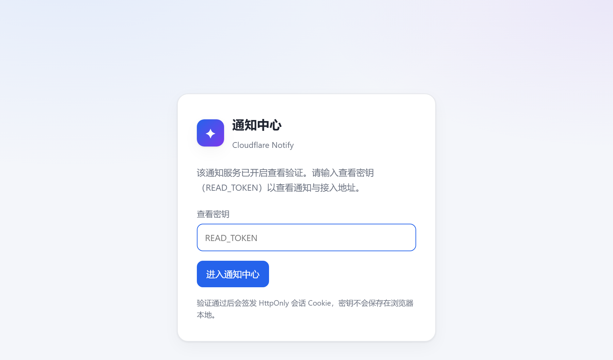

# Cloudflare Notify

一个参考「方糖 / ServerChan」思路的最小通知工具：部署在 **Cloudflare Workers** 上，用一个 URL 或一次 API 调用发送消息，打开网页即可查看，无需自建服务器。

零成本核心：Workers 免费额度 + KV 免费额度 + 免费自定义域名 + 免费 SSL。



**[在线体验 →](https://ntfy.588816.xyz/)** · 部署教程：[GITHUB_DEPLOY.md](GITHUB_DEPLOY.md) · 排错手册：[TROUBLESHOOTING.md](TROUBLESHOOTING.md)

---

## 1. 功能特性

| 能力 | 说明 |
| --- | --- |
| URL 发消息 | `GET /send?token=...&title=...&content=...`，浏览器、curl、快捷指令、Webhook 都能用 |
| API 发消息 | `POST /api/send`，支持 JSON 与表单，兼容方糖的 `title` / `desp` 字段 |
| 即时查看 | Web 页面每 5 秒自动轮询，无需手动刷新 |
| 通知折叠 | 折叠时显示**标题 + 内容摘要**（两行），不用展开也能读到正文；点击展开看全文，支持全部展开/折叠 |
| 统一面板布局 | 整页一个外框，内部用发丝线分区，不再是四张各自浮起的卡片 |
| 密钥分层与轮换 | `SEND_TOKEN` 为管理主密钥（只用于后台轮换），另有可一键随机生成的**轮换推送密钥**填给软件；换后旧密钥立即失效 |
| 三种安全传参 | 密钥可放 Header（`X-Token` / `Authorization: Bearer`）、POST body 或 URL，避免密钥进入 URL 历史与日志 |
| 双密钥 | `SEND_TOKEN` 控制发送/管理，`READ_TOKEN` 控制查看/清空；留空即公开 |
| **服务端鉴权页面** | 配置 `READ_TOKEN` 后，未验证的请求**只会拿到最小登录页**——里面根本没有推送地址与密钥 DOM，删掉任何遮罩也看不到 |
| **HttpOnly 会话 Cookie** | 验证通过签发 HMAC 签名的会话 Cookie（7 天），密钥不落 localStorage，JS/XSS 都读不到；改 `READ_TOKEN` 会让旧会话立即失效 |
| **Turnstile 人机验证** | 可选开启（默认关闭）。登录接口增加 Cloudflare Turnstile 挑战，**服务端 Siteverify 校验**（不信任前端 token），防暴力破解与脚本自动化 |
| 自定义域名 | Cloudflare 控制台一键绑定，自动签发证书 |
| 安全响应头 | 已设 CSP、nosniff、Referrer-Policy、X-Frame-Options、Permissions-Policy；CORS 默认收紧为同源 |

---

## 1.1 界面预览

### 通知中心（折叠态）

整页一个外框，内部用发丝线分区；通知折叠时**标题下方直接给出内容摘要**，不用逐条展开就能读到正文。


### 单条展开（完整正文）

点击任一条通知展开，保留原始换行并独立滚动；右上角可「全部展开 / 全部折叠」。



### 未鉴权时：服务端只下发登录页

配置了 `READ_TOKEN` 后，未验证的请求**只会拿到这一页**——推送地址与密钥的 DOM 根本不存在于响应体中，删掉任何遮罩也看不到。



---

## 2. 项目结构

```
cloudflare-notify/
├── worker.js            # ★ 单文件版（推荐部署）：路由 + KV + 内嵌 UI + 鉴权，一个文件全包
├── _worker.js           # 与 worker.js 完全相同（Pages advanced mode 入口，备用）
├── src/                 # 历史多文件实现，仅作参考，不参与部署
│   ├── index.js         # Worker 入口：路由、鉴权、请求解析
│   ├── messages.js      # KV 存储层：写入、列表、清空、计数
│   ├── utils.js         # 响应封装、安全响应头、Token 提取、会话 Cookie
│   └── ui.html          # 通知查看页面（内嵌进 Worker，无外部静态资源）
├── examples/            # 通用发送脚本（Python，零依赖）
├── docs/                # README / Release 用界面截图
│   ├── screenshot-notifications.png   # 通知中心（折叠态）
│   ├── screenshot-expanded.png        # 单条展开（完整正文）
│   └── screenshot-login.png           # 未鉴权时的独立登录页
├── wrangler.toml        # Cloudflare Workers 配置
├── package.json         # 依赖与脚本
├── .dev.vars.example    # 本地环境变量模板
├── .gitignore
├── GITHUB_DEPLOY.md     # 从 GitHub 导入的完整部署教程
├── TROUBLESHOOTING.md   # 常见问题排查
└── README.md
```

设计取舍：把 UI 作为文本导入内嵌到 Worker 中，整个服务只有 **一个 Worker + 一个 KV**，没有 Pages 项目、没有构建步骤、没有数据库，部署与迁移成本最低。

---

## 3. 核心接口与数据格式

### 3.1 接口一览

| 方法 | 路径 | 鉴权 | 说明 |
| --- | --- | --- | --- |
| `GET` | `/` | `READ_TOKEN` 或会话 Cookie（**服务端鉴权**） | 通知查看页面。未验证时只返回最小登录页，不含任何密钥/地址 DOM |
| `POST` | `/api/login` | 请求体 `{"token":"<READ_TOKEN>"}` | 验证通过签发 HttpOnly 会话 Cookie；失败次数过多返回 429。**启用 Turnstile 时还需带 `turnstileToken`** |
| `POST` | `/api/logout` | 无 | 清除会话 Cookie |
| `GET` | `/api/status` | `READ_TOKEN` 或会话 Cookie | 服务状态与是否启用密钥；`diagnostics` 含 Turnstile 配置自检 |
| `GET` | `/send` | 轮换密钥或 SEND_TOKEN | **通过 URL 发送消息（最简方式）** |
| `POST` | `/send` | 轮换密钥或 SEND_TOKEN | 表单发送消息 |
| `POST` | `/api/send` | 轮换密钥或 SEND_TOKEN | JSON / 表单发送消息（密钥可放 Header/body/query） |
| `GET` / `POST` | `/<key>.send` | key 为轮换密钥或 SEND_TOKEN | **方糖 / Server酱 兼容端点**，`text`/`title`=标题，`desp`=正文；返回 `errno` 与 `code` 双码 |
| `POST` | `/api/key/rotate` | **仅** SEND_TOKEN（管理主密钥） | 生成新轮换密钥并写入 KV，旧密钥立即失效；返回 `{ key }` |
| `GET` | `/api/key/current` | **仅** SEND_TOKEN | 查看当前轮换密钥 |
| `POST` | `/api/test-wecom` | 轮换密钥或 SEND_TOKEN | 测试企业微信 Webhook 连通性 |
| `GET` | `/api/messages?limit=50&version=...` | `READ_TOKEN` 或会话 Cookie | 获取通知列表；带 `version` 且无变化时只返回 `unchanged` |
| `GET` | `/api/count` | `READ_TOKEN` 或会话 Cookie | 通知总数 |
| `POST` | `/api/clear` | `READ_TOKEN` 或会话 Cookie | 清空全部通知 |

> **会话 Cookie 机制（v1.4.0）**：配置 `READ_TOKEN` 后，页面访问与只读 API 需要凭据。登录流程是
> `POST /api/login {"token":"<READ_TOKEN>"}` → 服务端校验通过后下发 `Set-Cookie: cfn_session=...`
> （HMAC-SHA256 签名、HttpOnly、SameSite=Strict、7 天有效）。后续请求浏览器自动带上该 Cookie。
>
> - 密钥**不写进 localStorage**，JS 读不到，XSS 也偷不走；
> - Cookie 签名用的是 `READ_TOKEN` 本身，所以**改了 `READ_TOKEN`，所有旧会话立刻失效**；
> - 直接访问 `/?token=<READ_TOKEN>` 也能进入：服务端会换发 Cookie 并 **302 到不带 token 的干净地址**，避免密钥留在浏览器历史里。
>
> **Turnstile 人机验证（v1.5.0，可选）**：启用后 `/api/login` 还需携带 `turnstileToken`（前端组件产出，服务端 Siteverify 校验）。
> 校验顺序是「先 Turnstile → 再比对 `READ_TOKEN`」，无法绕过；校验失败返回 401 且**不透露具体错误码**。详见 [4.3](#43-turnstile-人机验证可选-v150-起)。

| `OPTIONS` | 任意 | 无 | CORS 预检 |

### 3.2 发送消息

**方式 A：URL 直发（快捷指令 / 浏览器书签 / 只能填 URL 的软件）**

```
GET https://你的域名/send?token=<轮换密钥>&title=标题&content=正文
```

字段别名（兼容方糖习惯）：`title` 可写作 `text`，`content` 可写作 `desp`。

```
curl "https://你的域名/send?token=<轮换密钥>&title=构建完成&content=耗时%2023s&source=github-actions"
```

**方式 B：JSON API + Header 传密钥（推荐，密钥不进 URL）**

```bash
curl -X POST "https://你的域名/api/send" \
  -H "Content-Type: application/json" \
  -H "X-Token: <轮换密钥>" \
  -d '{"title":"告警","content":"CPU 85%","type":"text","source":"server"}'
```

密钥支持四种传法（优先级从高到低）：

```
X-Token: <key>              ← 推荐：不进 URL，不留历史/日志
Authorization: Bearer <key> ← 推荐：同上
POST body 的 token 字段     ← 推荐：同上
?token=<key> 或 ?sendkey=<key> ← 方便，但会进入 URL 历史/日志
```

**为什么不建议把密钥长期写在 URL 里**：URL 会被浏览器历史、服务器/代理日志、`Referer` 请求头、聊天记录与截图保存，泄露面远大于 Header/body。因此推荐：给软件的 key 用**轮换密钥**（泄露后一键作废），且能用 Header/body 就不用 URL。

**发送成功响应**

```json
{
  "ok": true,
  "code": 0,
  "message": "通知已接收",
  "data": {
    "id": "m1a2b3c4-x7k9p2q",
    "title": "构建完成",
    "content": "耗时 23s",
    "type": "text",
    "source": "github-actions",
    "timestamp": 1763281200000
  }
}
```

**失败响应**：HTTP 401 `{"ok":false,"error":"invalid token"}`；HTTP 400 表示标题和内容都为空。

### 3.3 密钥分层、轮换与安全加固

系统采用两级密钥，职责分离（自 v1.3）：

| 密钥 | 存放位置 | 用途 | 能否轮换 |
| --- | --- | --- | --- |
| **管理主密钥** `SEND_TOKEN` | Cloudflare Secret（运行时只读） | 后台管理：生成/查看轮换密钥；也可发送（兼容旧配置） | 否（需在后台改 Secret） |
| **轮换推送密钥** | KV `meta:sendkey`（64 位随机 hex） | 填进各个软件/URL，日常发送用 | **是，一键生成，旧的立即失效** |

**为何这样设计**：Workers 的 Secret 在运行时无法被代码修改，所以"可轮换的密钥"只能放 KV；而轮换接口本身需要一个不会被轮换掉的凭证鉴权，这个角色由 `SEND_TOKEN` 承担。因此 `SEND_TOKEN` 应视为管理凭证，**绝不填进软件或 URL**；软件里填轮换密钥。

**生成轮换密钥**（Web 页面已内置按钮，也可用 API）：

```bash
# 用管理主密钥鉴权生成新密钥（Header 或 query 均可）
curl -X POST "https://你的域名/api/key/rotate" -H "X-Token: <SEND_TOKEN>"

# 返回：{"ok":true,"key":"<64位新密钥>","hint":"..."}
# 旧密钥此刻起立即失效，把返回的 key 填进软件替换旧值

# 查看当前轮换密钥
curl "https://你的域名/api/key/current" -H "X-Token: <SEND_TOKEN>"
```

> 注意：轮换接口只认 `SEND_TOKEN`，轮换密钥无权调用——防止拿到推送密钥的人反过来轮换掉密钥造成拒绝服务。前提是已设置 `SEND_TOKEN`；未设置时轮换接口返回 401。

**让密钥更安全的六种做法（按推荐度）**：

1. **分层**：软件只用轮换密钥，`SEND_TOKEN` 只在后台管理用，永不出现在链接中。
2. **换传参**：优先用 Header（`X-Token`/`Authorization: Bearer`）或 POST body，密钥不进 URL，避免浏览器历史、日志、`Referer` 与截图泄露。
3. **定期轮换**：一旦怀疑泄露，立刻点"生成新推送密钥"，旧 key 即时失效，无需重新部署。
4. **一软件一密钥**（进阶）：本 Demo 只维护一个当前密钥；如需按软件隔离，可给不同软件轮换并分别记录，代价是管理复杂度上升。
5. **绑定自定义域名 + HTTPS**：走自己的域名，避免 `workers.dev` 的不稳定与中间环节；Cloudflare 自动签发免费证书。
6. **控制查看权限**：设置 `READ_TOKEN`，避免任何人都能读取全部通知内容。

> 仍有边界需要说明：只要软件只能填 URL（方糖类），key 就必然出现在那一条 URL 里，无法做到"密钥完全不进 URL"。能做的上限是「用可随时作废的轮换密钥 + 定期轮换」，把泄露窗口压到最小；签名/HMAC 这类防重放机制对只支持填 URL 的软件无能为力，故本 Demo 未引入。

**平台侧纵深防御（v1.3.1 起，无需配置，已内置）**：

| 措施 | 作用 |
| --- | --- |
| `Content-Security-Policy` | 限制脚本/样式来源为 self + 内联、禁止外部资源与 iframe 嵌套，缓解 XSS 数据外带 |
| `X-Content-Type-Options: nosniff` | 禁止 MIME 嗅探，防类型混淆攻击 |
| `Referrer-Policy: no-referrer` | 页面不向外站发送来源信息 |
| `X-Frame-Options: DENY` + CSP `frame-ancestors 'none'` | 防点击劫持 |
| `Permissions-Policy` | 禁用摄像头/麦克风/定位/支付等无关能力 |
| CORS 默认同源 | 移除旧版 `Access-Control-Allow-Origin: *`，跨站脚本无法读取 API；同源页面、curl、服务端 Webhook 不受影响 |
| 错误脱敏 | 内部异常只写 console、对客户端返回通用错误；`/api/status` 同样需要鉴权，不回传底层异常原文 |
| 输出转义 | 所有通知字段经 HTML 实体转义后渲染，折叠交互用事件委托而非内联 `onclick` |

**v1.4.0 新增的访问控制加固**：

| 措施 | 作用 |
| --- | --- |
| **服务端鉴权下发页面** | 配置 `READ_TOKEN` 后，未验证的请求**只返回最小登录页**。推送地址、密钥、通知列表这些 DOM 在未鉴权响应里**根本不存在**——用开发者工具删掉任何遮罩 div 也拿不到（v1.3 的遮罩只是纯前端显示，删掉即可见，属于真实漏洞） |
| **HttpOnly 会话 Cookie** | 验证通过签发 HMAC-SHA256 签名的 `cfn_session` Cookie（HttpOnly / SameSite=Strict / 7 天）。密钥不落 localStorage，JS 与 XSS 都读不到 |
| **签名可失效** | 会话签名密钥就是 `READ_TOKEN`，改 `READ_TOKEN` 等于一键踢掉所有旧会话 |
| **常量时间比较** | 密钥比对用 `timingSafeEqual`，避免时序侧信道逐字节猜密钥 |
| **登录限速** | 同一 IP 5 分钟内失败 8 次即锁 5 分钟，返回 429（Worker 内尽力而为；正式环境建议再叠一层 WAF 规则） |
| **URL 密钥不落地** | `/?token=<READ_TOKEN>` 会被换发 Cookie 并 302 到干净地址，密钥不留在浏览器历史/Referer |
| **会话失效即清屏** | 运行中会话过期时，前端立刻抹掉已渲染的密钥与推送地址，再要求重新验证 |

> 说明：UI 是单文件内嵌（内联 `<script>`/`<style>` 是其运行前提），因此 CSP 保留了 `'unsafe-inline'`。若要进一步收紧为纯 `'self'`，需把脚本与样式拆成独立静态资源，届时将不再是单文件部署。

> **边界说明**：会话 Cookie 防的是「网页被打开 / 被别人翻到」这类场景。若攻击者已经拿到了 `READ_TOKEN` 或 `SEND_TOKEN` 本身，任何前端防护都挡不住——所以密钥本身仍需妥善保管，建议用轮换密钥 + 定期轮换。

### 3.4 读取消息

```
GET /api/messages?limit=50
GET /api/messages?limit=50&version=<上次响应中的 version>   # 增量检查
```

```json
{
  "ok": true,
  "unchanged": false,
  "version": "1763281200000",
  "count": 1,
  "messages": [
    {
      "id": "m1a2b3c4-x7k9p2q",
      "title": "构建完成",
      "content": "耗时 23s",
      "type": "text",
      "source": "github-actions",
      "timestamp": 1763281200000
    }
  ]
}
```

`limit` 取值 1–200，默认 50。`timestamp` 为毫秒级 Unix 时间戳。
当客户端传入的 `version` 与服务端一致时，响应为 `{"ok":true,"unchanged":true,"version":"..."}`，Worker **不会读取全量列表**，这是控制免费额度的关键机制。

### 3.4 KV 数据格式

每条消息一个 KV 对象：

- **Key**：`msg:<16 位倒序时间戳>-<唯一 ID>`。倒序时间戳让 `KV.list()` 的字典序结果天然按时间倒序，避免全量排序。
- **Value**：上述消息对象的 JSON 字符串。
- **Metadata**：`{ id, timestamp }`（纯 ASCII，避免内部头编码兼容问题）。

---

## 4. Cloudflare 配置与环境变量

### 4.1 `wrangler.toml` 关键项

```toml
name = "cloudflare-notify"          # 决定 *.workers.dev 子域名
main = "worker.js"                  # 单文件版（推荐）；src/ 为历史多文件实现
compatibility_date = "2026-11-16"

[[kv_namespaces]]
binding = "NOTIFICATIONS"
id = "你的_KV_命名空间_ID"
preview_id = "你的_预览_KV_ID"      # wrangler dev --remote 时使用

[vars]
APP_NAME = "Cloudflare Notify"      # 非敏感变量
```

### 4.2 环境变量

| 变量 | 类型 | 必填 | 位置 | 说明 |
| --- | --- | --- | --- | --- |
| `SEND_TOKEN` | Secret | 建议 | `.dev.vars` / `wrangler secret put` | **管理主密钥**：轮换/查看推送密钥，也可发送；不进 URL；不设置则任何人可发送且无法轮换 |
| `READ_TOKEN` | Secret | 可选 | 同上 | 查看与清空密钥；不设置则页面公开 |
| `WECOM_WEBHOOK` | Secret | 可选 | 同上 | 企业微信群机器人 Webhook；配置后消息主动推到群 |
| `TURNSTILE_SITE_KEY` | var | 可选 | `.dev.vars` / Dashboard → Variables | Turnstile 公开 site key（`0x` 开头）；必须与 `TURNSTILE_SECRET_KEY` **同时设置**才启用 |
| `TURNSTILE_SECRET_KEY` | Secret | 可选 | `wrangler secret put` | Turnstile secret key；只放 Secrets，绝不写进代码 |
| `TURNSTILE_API_ORIGIN` | var | 可选 | 同上 | 中国大陆部署用 `https://challenges.cloudflare-cn.com`；留空 = 全球站 |
| `APP_NAME` | var | 否 | `wrangler.toml` | 展示名称 |
| `meta:sendkey` | KV（自动生成） | 否 | Dashboard KV / 轮换接口 | 轮换推送密钥，软件填这个；由 `/api/key/rotate` 写入，无需手动配置 |

本地：

```bash
cp .dev.vars.example .dev.vars
# 编辑 .dev.vars，设置 SEND_TOKEN 与 READ_TOKEN
```

线上（密钥不要写进 `wrangler.toml`）：

```bash
npx wrangler secret put SEND_TOKEN
npx wrangler secret put READ_TOKEN
```

### 4.3 Turnstile 人机验证（可选，v1.5.0 起）

给登录接口 `/api/login` 加一层 Cloudflare Turnstile 挑战，防暴力破解和脚本自动化。

**默认关闭，不配置就完全不影响现有部署**（不加载任何外部资源、不放宽 CSP）。

#### 开通步骤

1. Cloudflare Dashboard → 左侧 **Turnstile** → **Add widget**
2. 填写：
   - **Widget name**：随意，例如 `cloudflare-notify`
   - **Widget Domain**：填你的部署域名（如 `ntfy.588816.xyz`）；本地调试可额外加 `localhost`
   - **Widget Mode**：选 **Managed**（默认，Cloudflare 自动判定风险）
3. 创建后拿到两个 key：
   - **Site Key**（`0x` 开头）—— 公开，可放普通变量
   - **Secret Key** —— 保密，**只能放 Secrets**

#### 配置

```bash
# 公开 site key，放普通变量即可
npx wrangler secret put TURNSTILE_SITE_KEY      # 或写进 wrangler.toml [vars]

# secret key，只能走 Secrets
npx wrangler secret put TURNSTILE_SECRET_KEY
```

Dashboard 对应位置：**Settings** → **Variables and Secrets**。

#### 三个关键设计（为什么不填也能用）

| 设计 | 原因 |
| --- | --- |
| **两个变量必须同时存在才启用** | 只配一个 → 视为「未启用」，并在 `/api/status` 标 `misconfigured: true`。这样配错半个不会把人锁在门外 |
| **服务端 Siteverify 校验，不信前端 token** | 官方明确：客户端组件本身**不构成保护**，token 可伪造。必须在服务端调 `https://challenges.cloudflare.com/turnstile/v0/siteverify` 校验 `secret` + `response` |
| **失败后前端自动 reset()** | token **单次使用**、生成后 **300 秒过期**，校验失败必须重新挑战，不能复用旧 token |

#### 其他说明

- **CSP 自动放行**：启用后 `script-src` 与 `frame-src` 自动加入 `https://challenges.cloudflare.com`；未启用时 CSP 与之前完全一致。
- **中国大陆部署**：设置 `TURNSTILE_API_ORIGIN=https://challenges.cloudflare-cn.com`，组件与校验接口同步切到中国区源站。
- **测试密钥**：Cloudflare 提供官方测试 site key（`1x00000000000000000000AA`）与 secret key（`1x0000000000000000000000000000000AA`），恒定通过，可用于本地自测。
- **自检**：`GET /api/status` 的 `diagnostics` 里会返回 `turnstileEnabled` / `turnstileSiteKeySet` / `turnstileSecretKeySet` / `turnstileMisconfigured`，主界面「系统自检」面板也会显示。
- **组件容器不能 `display:none`**：那样 iframe 会拿到 0 尺寸导致组件显示异常。实现上采用「容器可见后再 render()」策略（`offsetWidth/offsetHeight/getClientRects()` 检测 + 50ms 重试），登录弹层第二次弹出也能正常渲染。

---

## 5. 自定义域名绑定要点

1. **前提**：域名需接入当前 Cloudflare 账户（免费计划即可），且处于 Active 状态。
2. **绑定路径**：Cloudflare Dashboard → **Workers & Pages** → `cloudflare-notify` → **Settings** → **Triggers** → **Custom Domains** → **Add Custom Domain**。
3. 输入完整域名，如 `notify.example.com`，Cloudflare 会自动完成：
   - 添加 `CNAME` 记录指向 Worker；
   - 签发并续期 Universal SSL 证书。
4. **根域名**（`example.com`）同样支持；若与 `@` 的 A 记录冲突，先删除冲突记录。
5. 生效时间通常为数分钟到数小时（取决于 DNS TTL）。
6. 绑定后 `*.workers.dev` 地址仍可用；如需关闭，在 Settings 中禁用即可。
7. 也可以通过 Wrangler 配置路由（适用于已有 Zone）：

```toml
[[routes]]
pattern = "notify.example.com/*"
zone_name = "example.com"
```

> 注意：使用 `[[routes]]` 时域名所在 Zone 必须在本账户内；两种绑定方式不要重复配置同一域名。

---

## 6. 本地运行与验证步骤

### 6.1 环境准备

- Node.js 18+（含 npm）
- 一个 Cloudflare 账户（免费即可）

### 6.2 本地启动

```bash
cd cloudflare-notify
npm install
cp .dev.vars.example .dev.vars     # 按需修改密钥
npm run dev
```

默认地址：`http://localhost:8787`。本地 KV 由 Wrangler 自动模拟，数据保存在 `.wrangler/state`，**无需先创建线上 KV**。

### 6.3 本地接口验证

```bash
# 1) 查看状态
curl http://localhost:8787/api/status

# 2) 发送（把 TOKEN 换成 .dev.vars 里的 SEND_TOKEN）
curl "http://localhost:8787/send?token=TOKEN&title=测试&content=Hello%20World&source=local"

# 3) 读取列表（若设了 READ_TOKEN，加 -H "X-Token: TOKEN"）
curl "http://localhost:8787/api/messages?limit=10"

# 4) 统计
curl "http://localhost:8787/api/count"

# 5) 错误鉴权：应返回 401
curl -i "http://localhost:8787/send?title=无密钥"

# 6) 清空
curl -X POST "http://localhost:8787/api/clear"
```

浏览器打开 `http://localhost:8787`：若设置了 `READ_TOKEN` 会弹出登录框；输入后应看到刚才发送的通知，并在 5 秒内自动更新。

### 6.4 部署到 Cloudflare

```bash
# 1) 登录 Cloudflare
npx wrangler login

# 2) 创建 KV 命名空间，把输出的 id / preview_id 回填到 wrangler.toml
npm run kv:create

# 3) 设置线上密钥（交互式输入）
npx wrangler secret put SEND_TOKEN
npx wrangler secret put READ_TOKEN

# 4) 部署
npm run deploy
```

部署成功后终端会输出 Worker URL，例如 `https://cloudflare-notify.<子域>.workers.dev`。

### 6.5 线上验证

```bash
BASE="https://cloudflare-notify.<子域>.workers.dev"

curl "$BASE/api/status"
curl "$BASE/send?token=<SEND_TOKEN>&title=线上测试&content=部署成功"
curl -H "X-Token: <READ_TOKEN>" "$BASE/api/messages"
```

再用浏览器打开 Worker URL 与自定义域名，确认页面能加载、消息能显示。可用 `npm run tail` 实时查看运行日志排查问题。

---

## 7. 免费额度与限制

| 资源 | 免费额度 | 对本工具的影响 |
| --- | --- | --- |
| Workers 请求 | 100,000 次/天 | 页面每 5 秒轮询约 17,280 次/天（单人常开），额度充足 |
| KV 读取 | 100,000 次/天 | **增量检查**下无新消息时每次轮询仅 1 次读取（约 17,280/天）；有新消息时额外 1 次 list + N 次 get |
| KV 写入 | 1,000 次/天 | 发送一次 = 2 次写入（消息 + 版本号），个人通知足够 |
| KV 存储 | 1 GB | 单条正文上限 20,000 字符 |
| 自定义域名 / SSL | 免费且不限 | 可绑定多个域名 |

优化机制与建议：
- **增量检查（默认开启）**：Web UI 轮询时携带上次响应的 `version`；无新消息时 Worker 只读一个版本号 key，不拉取消息列表，把每次轮询的 KV 读取量从「1 + 消息条数」降到 1。
- 页面处于后台标签页时自动暂停轮询。
- 若仍接近上限，把 `src/ui.html` 中的 `REFRESH_MS` 调大（如 15000，约 5,760 次/天）。
- 消息长期不清理会占满列表；可定期调用 `/api/clear`，或在页面点击「清空」。

---

## 8. 常见用法示例

**GitHub Actions**

```yaml
- name: 发送通知
  run: |
    curl -sG "https://notify.example.com/send" \
      --data-urlencode "token=${{ secrets.SEND_TOKEN }}" \
      --data-urlencode "title=构建完成" \
      --data-urlencode "content=分支 ${{ github.ref_name }} 已部署"
```

**iOS 快捷指令**：「获取 URL 内容」→ URL 填入带 `token/title/content` 的 `/send` 地址，GET 请求即可。

**Linux 定时任务**

```bash
curl -sG "https://notify.example.com/send" \
  --data-urlencode "token=xxx" \
  --data-urlencode "title=备份完成" \
  --data-urlencode "content=$(date)"
```
